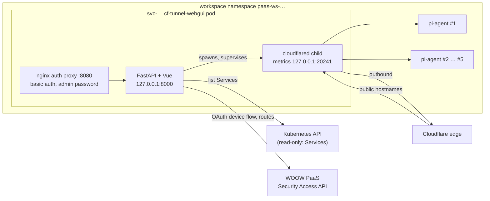

<p align="center">
  
</p>

<h1 align="center">Cloudflare Tunnel WebGUI — PaaS edition</h1>

<p align="center">
  <strong>Publish the services of a WOOW PaaS workspace through a Cloudflare tunnel, from a browser.</strong>
</p>

<p align="center">
  <a href="README_zh-TW.md">繁體中文</a> &bull;
  <a href="#how-it-works">How it works</a> &bull;
  <a href="#the-chart">The chart</a> &bull;
  <a href="docs/paas-api.md">API contract</a> &bull;
  <a href="#development">Development</a>
</p>

---

This is the third edition of the WOOW Cloudflare Tunnel web GUI. The other two
are the [Podman edition](https://github.com/WOOWTECH/Woow_podman_cf_tunnel_webgui)
and the [Home Assistant add-on](https://github.com/WOOWTECH/Woow_ha_cf_tunnel_webgui).
It has the same five pages and the same three ways to connect:

| Page | What it does |
|---|---|
| Dashboard | tunnel state (edge connections), start / stop / restart |
| PaaS 連結 | link a WOOW PaaS **Security Access** with the device code, review its routes, connect, release, test the public URLs |
| Setup | log in to **your own Cloudflare account**, create a tunnel, create DNS routes (local-managed mode) |
| Config | paste a **tunnel token**, routes, catch-all, post-quantum, log level, run parameters |
| Logs | live cloudflared output, secrets redacted |

What the PaaS edition adds is the **workspace**: it runs as a service inside a
PaaS workspace and lists the other services of that workspace. Tick five
pi-agents, give them names, and they are published in one action:

- **PaaS link**: the WebGUI adds the routes to the linked Security Access through
  the platform (`<name>.woowtech.io`), and the platform pushes them to the tunnel.
- **Setup (your own Cloudflare)**: the routes go into the local ingress and the
  DNS records are created with your Cloudflare login.
- **Config (token)**: the routes of a token-mode tunnel live in the Cloudflare
  dashboard; the picker gives you the list to enter there.

## Editions

| | Podman | Home Assistant add-on | Kubernetes (k3s) |
|---|---|---|---|
| **WOOW** (aiot.woowtech.io) | [Woow_podman_cf_tunnel_webgui](https://github.com/WOOWTECH/Woow_podman_cf_tunnel_webgui) | [Woow_ha_cf_tunnel_webgui](https://github.com/WOOWTECH/Woow_ha_cf_tunnel_webgui) | [Woow_k3s_cf_tunnel_webgui](https://github.com/WOOWTECH/Woow_k3s_cf_tunnel_webgui) |
| **Apporo** (www.apporo.ai) | [Apporo_podman_cf_tunnel_webgui](https://github.com/WOOWTECH/Apporo_podman_cf_tunnel_webgui) | [Apporo_ha_cf_tunnel_webgui](https://github.com/WOOWTECH/Apporo_ha_cf_tunnel_webgui) | [Apporo_k3s_cf_tunnel_webgui](https://github.com/WOOWTECH/Apporo_k3s_cf_tunnel_webgui) |

Tutorial (HA add-on, Traditional Chinese): [Woow_ha_cf_tunnel_tutorial_site](https://github.com/WOOWTECH/Woow_ha_cf_tunnel_tutorial_site) · https://ha-cloudflare-tunnel-guide.woowtech.io

## How it works



- The app listens on loopback only. The pod's only entrance is the nginx proxy,
  whose basic-auth password is the service's admin password from the platform
  (reset it in the platform and the pod restarts with the new one).
- cloudflared runs as a child of the app. If it exits while it should be
  running, the app starts it again (after 2, 5, 10, 30, 60 s). The liveness
  probe watches the app only, so a tunnel problem never restarts the pod.
- `/data` (a 1Gi volume) keeps the settings, the tunnel token, `cert.pem`,
  `tunnel.json` and the PaaS link state, each file 0600.
- A route's service is an in-namespace address such as
  `http://svc-11111111-pi-agent:8080`; the namespace network policy lets this
  pod reach every service of the workspace and nothing in other workspaces.

## The chart

`charts/cf-tunnel-webgui` follows the WOOW PaaS chart contract: one Service with
the release's `app.kubernetes.io/instance` label on port 8080,
`config.sensitive.admin_password` for the platform-managed password,
`persistence.size` / `persistence.storageClass`, `imagePullSecrets` /
`global.imagePullSecrets`, top-level `resources`.

| Value | Default | Meaning |
|---|---|---|
| `paas.apiBase` | `https://aiot.woowtech.io` | platform of the PaaS link |
| `paas.portalBase` | = `apiBase` | portal links |
| `paas.clientId` | `woow-ha-smart-home` | OAuth client (`woow-cf-tunnel-webgui` on platforms that have it) |
| `paas.routesWrite` | `false` | the platform grants `security-access:routes` (bulk publish) |
| `paas.routeDomain` | `woowtech.io` | hostname = `<prefix>.<routeDomain>` |
| `rbac.create` | `true` | Role to list the namespace's Services |
| `networkPolicy.apiServerCidrs` | `[10.43.0.1/32]` | egress to the Kubernetes API (the platform injects the cluster's control-plane IPs) |
| `persistence.size` | `1Gi` | the `/data` volume |

The image is `ghcr.io/woowtech/cf-tunnel-webgui`, built for amd64 and arm64 by
`.github/workflows/release.yml`.

## Development

```bash
python -m venv .venv && .venv/bin/pip install -r requirements-dev.txt
.venv/bin/python -m pytest -m "not e2e" -q
cd frontend && npm ci && npm test && npm run build
helm lint --strict charts/cf-tunnel-webgui
```

Run it outside Kubernetes (the workspace list then says it is not in a
workspace):

```bash
docker build -t cf-tunnel-webgui:dev .
docker run --rm -p 18000:8000 -e UVICORN_HOST=0.0.0.0 cf-tunnel-webgui:dev
```

## Security

- Never expose port 8000: the app has no login of its own. The chart keeps it on
  loopback behind the auth proxy.
- State-changing requests need the CSRF header; WebSockets are accepted only
  from a page of the same origin.
- The tunnel token, OAuth tokens and `cert.pem` never reach the browser.
- The Role can only read Services and EndpointSlices of the namespace.

## License

MIT
